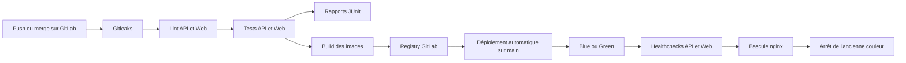

# Architecture et pipeline CI/CD

## Technologies

| Élément | Technologie | Justification |
| --- | --- | --- |
| API | Go 1.22 | Binaire statique, faible consommation et tests rapides |
| Interface Web | React, TypeScript et Vite | Développement rapide d'un dashboard typé |
| Base de données | PostgreSQL 16 | Base relationnelle robuste adaptée aux produits, ventes et indicateurs |
| Reverse proxy | nginx | Point d'entrée stable et bascule blue/green sans interruption |
| Conteneurs | Docker Compose | Environnements reproductibles et services isolés |
| CI/CD | GitLab CE et GitLab Runner | Dépôt, registry, tests et déploiement réunis sur une plateforme auto-hébergée |
| Sécurité | Gitleaks et variables GitLab | Détection des secrets dans les fichiers et l'historique |

L'application mobile SwiftUI consommera ultérieurement la même API REST. Elle n'est pas compilée dans cette première partie, car un build iOS nécessite un runner macOS avec Xcode.

## Services

- `db` conserve les données PostgreSQL dans un volume persistant.
- `api-blue` ou `api-green` exécute le binaire Go et expose un healthcheck interne.
- `web-blue` ou `web-green` sert les fichiers statiques React avec nginx.
- `trinity-proxy` reste exposé sur le port 80 et dirige le trafic vers la couleur active.

GitLab et le runner sont séparés : un build Docker intensif ne doit pas rendre l'interface GitLab indisponible. Le runner accède au moteur Docker de sa VM par `/var/run/docker.sock`.

## Développement et production

| Aspect | Développement | Production |
| --- | --- | --- |
| API | `go run .` dans `golang:1.22-alpine` | Build multi-stage, binaire statique dans une image distroless non-root |
| Web | Serveur Vite sur le port 5173 avec volume source | Build Vite multi-stage, fichiers statiques servis par nginx |
| Sources | Montées depuis la machine hôte | Absentes des images finales |
| Configuration | `.env.dev`, local et ignoré par Git | Variables CI/CD GitLab protégées |
| Images | Construites localement | Taguées avec le SHA du commit et stockées dans le registry GitLab |
| Disponibilité | Un exemplaire de chaque service | Déploiement blue/green avec healthchecks avant bascule |
| Redémarrage | Manuel | `restart: unless-stopped` |

Les images de production sont plus petites et ne contiennent ni compilateur ni dépendances de développement. L'API s'exécute avec l'utilisateur non-root fourni par Distroless.

## Pipeline CI/CD

### Security

Gitleaks récupère tout l'historique avec `GIT_DEPTH: "0"`. Une détection arrête immédiatement le pipeline avant les tests, les builds et le déploiement. Les valeurs détectées sont masquées avec `--redact`.

### Lint

`golangci-lint` contrôle l'API. TypeScript avec `tsc --noEmit` contrôle le Web. Toute erreur bloque les étapes suivantes.

### Tests

`go test` et Vitest exécutent les tests automatisés. Les résultats sont convertis en rapports JUnit et publiés comme artifacts GitLab, même en cas d'échec.

### Build

Les jobs `build-api` et `build-web` déclarent leurs dépendances avec `needs`. Ils construisent les Dockerfiles de production, taguent chaque image avec `CI_COMMIT_SHORT_SHA`, puis la poussent dans le Container Registry.

### Deploy

Le déploiement est automatique uniquement sur la branche par défaut. Le script `deploy/deploy.sh` :

1. maintient PostgreSQL et le proxy en fonctionnement ;
2. choisit la couleur inactive ;
3. télécharge et démarre les nouvelles images ;
4. attend les healthchecks API et Web ;
5. recharge nginx vers la nouvelle couleur ;
6. arrête l'ancienne couleur.

Une version défectueuse ne reçoit donc jamais de trafic. Un test réel de 1 500 requêtes pendant une bascule blue vers green a produit 1 500 réponses HTTP 200 et aucune interruption.

## Déclencheurs et environnements

- Chaque push lance Gitleaks, lint, tests et builds.
- Les merge requests exécutent les mêmes contrôles avant fusion.
- Seule la branche par défaut déclenche `deploy-prod`.
- L'environnement GitLab `production` enregistre les déploiements.
- Les variables PostgreSQL protégées ne sont disponibles que pour les branches protégées.
