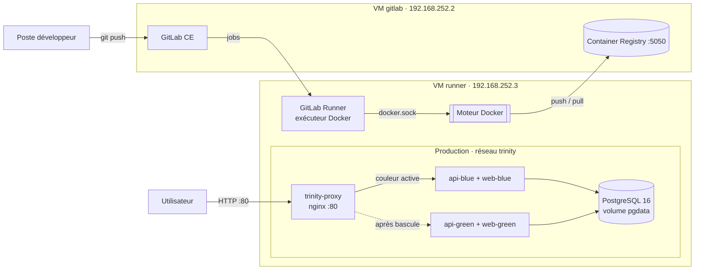
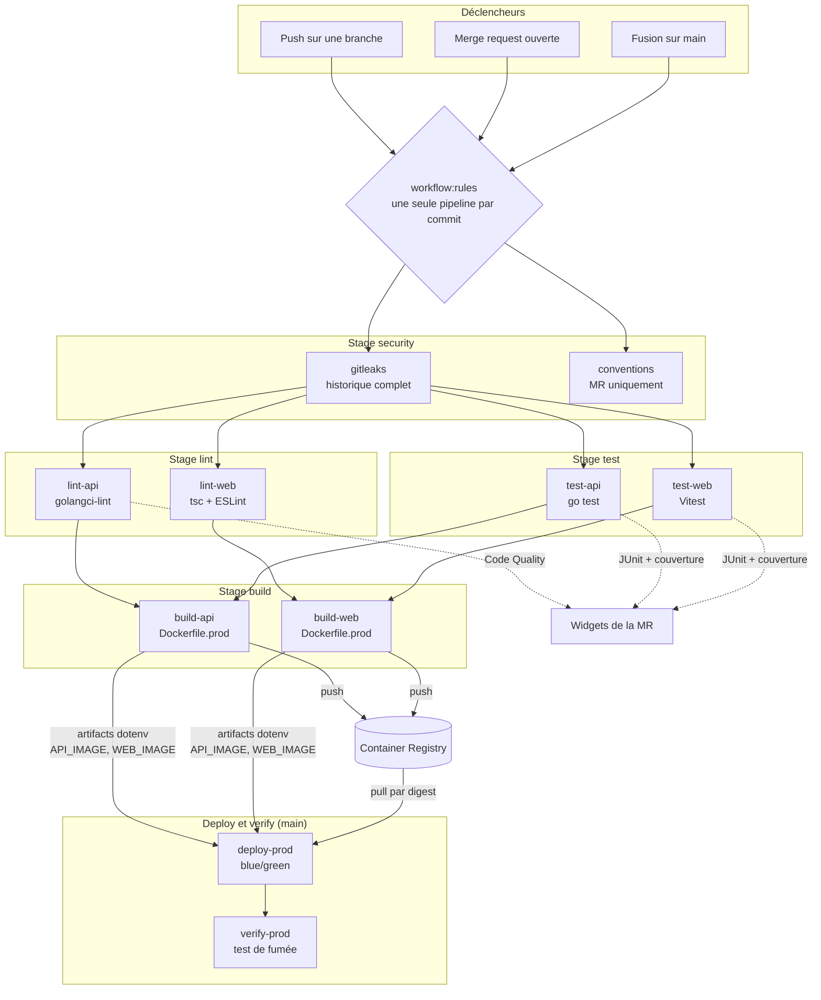

# Architecture et pipeline CI/CD

## Technologies

| Élément | Technologie | Justification |
| --- | --- | --- |
| API | Go 1.27 | Binaire statique sans dépendance système, démarrage instantané, faible consommation mémoire, tests intégrés au langage |
| Accès base | pgx v5 (pool de connexions) | Driver PostgreSQL natif le plus utilisé en Go, sans ORM pour garder des requêtes explicites |
| Interface Web | React 18, TypeScript et Vite 8 | Écosystème standard pour un back-office ; le typage limite les régressions, Vite build en moins d'une seconde |
| Base de données | PostgreSQL 16 | Base relationnelle robuste adaptée aux produits, ventes, stocks et indicateurs |
| Reverse proxy | nginx | Point d'entrée stable et bascule blue/green sans interruption |
| Conteneurs | Docker et Docker Compose | Environnements dev et prod reproductibles, services isolés |
| CI/CD | GitLab CE, Container Registry et GitLab Runner | Dépôt, pipeline, images et déploiement sur une seule plateforme auto-hébergée |
| Qualité | golangci-lint, ESLint, `tsc`, Vitest, `go test` | Lint et tests exécutés à chaque commit, rapports lisibles dans GitLab |
| Sécurité | Gitleaks, variables CI/CD masquées et protégées | Aucun secret dans le dépôt ni dans son historique |

L'application mobile (partie 801) consommera la même API REST. Elle n'est pas construite dans cette première partie, car un build iOS nécessite un runner macOS avec Xcode.

### Pourquoi ces choix

- **Une API REST unique** sert le back-office web et l'application mobile : une seule logique métier à tester et déployer.
- **Go** produit un exécutable autonome : l'image de production ne contient que ce fichier (19 Mo), sans shell ni gestionnaire de paquets, donc avec une surface d'attaque minimale.
- **React et Vite** sont compilés en fichiers statiques : en production, aucun Node.js ne tourne, nginx sert le build.
- **GitLab auto-hébergé** répond à la contrainte du sujet et réunit dépôt, registry d'images et exécution du pipeline, sans service externe.

## Arborescence du projet

```text
Trinity/
├── api/                        API REST en Go
│   ├── main.go                 démarrage, connexion PostgreSQL, sous-commande healthcheck
│   ├── handler.go              routes HTTP (/api/health, /api/health/db)
│   ├── handler_test.go         tests unitaires (base simulée)
│   ├── .golangci.yml           règles de lint
│   ├── Dockerfile.dev          image de développement (go run)
│   └── Dockerfile.prod         build multi-stage vers une image distroless non-root
├── web/                        back-office React + TypeScript
│   ├── src/                    code source et tests Vitest
│   ├── eslint.config.js        règles de lint
│   ├── vite.config.ts          serveur de dev, proxy /api, couverture de tests
│   ├── nginx.conf              configuration nginx de l'image de production
│   ├── Dockerfile.dev          serveur Vite avec rechargement à chaud
│   └── Dockerfile.prod         build Vite multi-stage servi par nginx
├── deploy/
│   ├── compose.dev.yml         environnement de développement complet
│   ├── compose.infra.yml       production : PostgreSQL et proxy nginx (permanents)
│   ├── compose.app.yml         production : une couleur (blue ou green) de l'API et du Web
│   └── deploy.sh               déploiement blue/green sans interruption
├── scripts/
│   └── check-conventions.sh    vérification des branches et commits en merge request
├── docs/                       documentation
├── .gitlab/                    modèle de merge request
├── .gitlab-ci.yml              pipeline CI/CD
├── .env.example                modèle de configuration locale (sans secret)
└── CONTRIBUTING.md             conventions de branches, commits et merge requests
```

Chaque composant (`api`, `web`) est autonome : son propre Dockerfile, ses dépendances, ses tests et ses jobs de pipeline. Les fichiers de déploiement sont regroupés dans `deploy/`.

## Architecture d'exécution



- **GitLab et le runner sont séparés** : un build Docker intensif ne doit pas rendre l'interface GitLab indisponible.
- Le runner exécute chaque job dans un conteneur et accède au moteur Docker de sa VM par `/var/run/docker.sock` pour construire les images et déployer.
- **La production tourne sur la VM runner.** PostgreSQL et le proxy sont permanents (`compose.infra.yml`) ; l'API et le Web existent en deux couleurs, dont une seule reçoit le trafic.

### Services de production

| Service | Image | Rôle | Healthcheck |
| --- | --- | --- | --- |
| `trinity-proxy` | `nginx:1.27-alpine` | Seul port exposé (80), route `/api/` vers l'API et `/` vers le Web de la couleur active | — |
| `api-blue` / `api-green` | `registry/api@sha256:…` | API Go, utilisateur non-root, se connecte à `db` via `DATABASE_URL` | `/api healthcheck` |
| `web-blue` / `web-green` | `registry/web@sha256:…` | Fichiers statiques React servis par nginx | `wget http://127.0.0.1/` |
| `db` | `postgres:16-alpine` | Données dans le volume persistant `pgdata` | `pg_isready` |

L'API expose deux endpoints de santé :

- `/api/health` : *liveness*, indépendante de la base. C'est elle que Docker utilise avant la bascule blue/green, pour qu'une base momentanément lente ne bloque pas un déploiement.
- `/api/health/db` : *readiness*, vérifie la connexion PostgreSQL (`200` ou `503`). Elle est appelée par le job `verify-prod` après chaque déploiement.

## Développement et production

| Aspect | Développement (`compose.dev.yml`) | Production (`compose.infra.yml` + `compose.app.yml`) |
| --- | --- | --- |
| API | `go run .` dans `golang:1.27-alpine` | Build multi-stage : binaire statique dans `distroless/static:nonroot` |
| Web | Serveur Vite (port 5173) avec rechargement à chaud | Build Vite multi-stage : fichiers statiques servis par `nginx:1.30-alpine` |
| Sources | Montées depuis l'hôte (volumes) | Absentes : seules les sorties de build sont copiées |
| Accès | API sur 8080, Web sur 5173 (proxy Vite vers `/api`) | Uniquement le proxy sur le port 80 |
| Configuration | `.env.dev` local, ignoré par Git | Variables CI/CD GitLab masquées et protégées |
| Images | Construites localement par Compose | Construites par la CI, poussées dans le registry, déployées par digest |
| Base | Volume `pgdata-dev` jetable | Volume `pgdata` persistant, jamais recréé par un déploiement |
| Disponibilité | Une instance de chaque service | Blue/green avec healthchecks avant bascule |
| Redémarrage | Manuel | `restart: unless-stopped` |
| Utilisateur | root (simplicité) | API non-root (uid 65532) |

Tailles des images de production : API 19 Mo, Web 96 Mo. Elles ne contiennent ni compilateur, ni sources, ni dépendances de développement. Les deux images sont analysées sans vulnérabilité HIGH ou CRITICAL (Trivy) ; l'image Web applique `apk upgrade` pour intégrer les correctifs Alpine publiés après l'image de base.

Le détail du lancement en local est décrit dans [development.md](development.md).

## Pipeline CI/CD

### Vue d'ensemble



Les flèches pleines sont les dépendances `needs` : un job démarre dès que les jobs dont il dépend ont réussi, sans attendre la fin du stage. Un échec arrête toute la branche du graphe qui en dépend ; rien n'est déployé.

### Déclencheurs

| Événement | Jobs exécutés |
| --- | --- |
| Push sur une branche sans MR | gitleaks, lint, test, build |
| Push sur une branche avec MR ouverte | conventions, gitleaks, lint, test, build (pipeline de MR, pas de doublon) |
| Fusion ou push sur `main` | gitleaks, lint, test, build, **deploy-prod, verify-prod** |
| Nouveau push pendant une pipeline | les jobs en cours de l'ancien commit sont annulés (`interruptible`), sauf le déploiement |

`main` est une branche protégée : elle n'accepte que des fusions de merge requests, et seules les branches protégées reçoivent les variables PostgreSQL de production.

### Étapes

**Security.** `gitleaks` analyse tout l'historique Git (`GIT_DEPTH: "0"`) et masque les valeurs trouvées (`--redact`). Une détection bloque tous les jobs suivants. Sur les merge requests, `conventions` vérifie le nom de la branche et chaque message de commit (voir [CONTRIBUTING.md](../CONTRIBUTING.md)).

**Lint.** `lint-api` exécute golangci-lint (linters standard, `bodyclose`, `misspell`, formatage `gofmt`) et publie un rapport *Code Quality* affiché dans la MR. `lint-web` exécute `tsc --noEmit` (types) puis ESLint (règles TypeScript et React Hooks).

**Test.** `test-api` exécute `go test` avec couverture ; `test-web` exécute Vitest avec couverture. Chaque job publie :

- un rapport **JUnit** (onglet *Tests* de la pipeline et widget de la MR), même en cas d'échec ;
- un rapport de **couverture Cobertura** (lignes couvertes dans le diff de la MR) ;
- le **pourcentage de couverture** extrait des logs et affiché sur le job.

Le code retour des tests est conservé pour publier le rapport avant de faire échouer le job.

**Build.** `build-api` ne dépend que de `lint-api` et `test-api` (de même pour le Web). Chaque job construit le `Dockerfile.prod` avec `--pull`, tague l'image avec `CI_COMMIT_SHORT_SHA`, la pousse dans le registry, puis écrit sa **référence immuable par digest** dans un artifact `dotenv` :

```text
API_IMAGE=192.168.252.2:5050/<groupe>/<projet>/api@sha256:1de07c…
```

**Deploy** (`main` uniquement). `deploy-prod` reçoit `API_IMAGE` et `WEB_IMAGE` depuis les artifacts des builds. Il déploie donc exactement l'image testée, même si un tag est réécrit entre-temps. Le script `deploy/deploy.sh` :

1. maintient PostgreSQL et le proxy en fonctionnement ;
2. choisit la couleur inactive ;
3. télécharge et démarre les nouvelles images ;
4. attend les healthchecks API et Web ;
5. recharge nginx vers la nouvelle couleur ;
6. arrête l'ancienne couleur.

Une version défectueuse ne reçoit donc jamais de trafic. Un test réel de 1 500 requêtes pendant une bascule blue vers green a produit 1 500 réponses HTTP 200 (voir [deployment-evidence.md](deployment-evidence.md)). Ce job n'est pas interruptible pour ne jamais couper une bascule en cours.

**Verify** (`main` uniquement). `verify-prod` interroge, à travers le proxy, la page Web, `/api/health` et `/api/health/db`. Un échec signale immédiatement un déploiement qui ne fonctionne pas réellement, par exemple une API qui ne joint pas la base.

### Artifacts et rapports

| Job | Artifact | Utilisation |
| --- | --- | --- |
| `lint-api` | `gl-code-quality-report.json` | Widget Code Quality de la MR |
| `test-api`, `test-web` | `report.xml` (JUnit) | Onglet *Tests*, widget de la MR |
| `test-api`, `test-web` | `coverage.xml` / `cobertura-coverage.xml` | Couverture dans le diff de la MR |
| `build-api`, `build-web` | `build.env` (dotenv) | Variables `API_IMAGE` et `WEB_IMAGE` de `deploy-prod` |

Les artifacts expirent après une semaine. Les jobs qui n'en ont pas besoin déclarent `artifacts: false` dans leurs `needs` pour ne pas les télécharger.

### Performances

Les modules Go et le cache npm sont conservés entre les pipelines (`cache` indexé sur `go.sum` et `package-lock.json`). Lint et tests des deux composants s'exécutent en parallèle.
